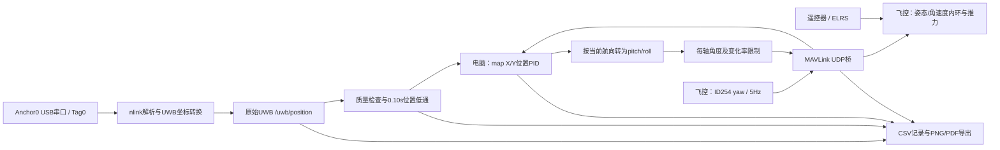

# Flapping-Wing UAV Navigation System

微型扑翼飞行器的 ROS 2 地面导航工程。电脑使用 UWB 位置和飞控回传的 yaw，完成航向对齐、水平定点/航点、直线与八字轨迹控制，并自动保存论文实验数据。

**当前默认控制：电脑位置 PID → 飞控姿态环，直接发送俯仰/滚转目标角，每轴限幅 ±30°。** 之前使用的“位置环→光流速度环→姿态环”已保留为显式选择的历史模式。本文的“三环/两环”按位置、速度、姿态三级任务划分；飞控内部的角速度内环一直存在，不包含在这个简称中。

本次归档将源码、配置、调试文档、**29 份实机实验会话及原始 CSV、图表、参数快照**一起提交。实机数据入口见 [实验索引](log/experiments/README.md)、[机器可读目录](log/experiments/catalog.csv)，归档范围和校验方法见 [日志归档说明](log/README.md)。部分会话可能是地面检查或未完成轨迹，不能仅凭目录名当作一次完整实飞。

## 1. 当前架构与职责



| 模块 | 当前作用 |
|---|---|
| `communication_backup.launch.py` | ELRS/Backpack 备用 UDP 链路，仅上下行通信，不采集或转发电脑 USB 遥控通道 |
| `communication.launch.py` | 旧图像板 UDP 链路，默认还运行 Pocket USB 采集和通道映射；与备用入口二选一 |
| `uwb_position_node` | 从 Anchor_Frame0 提取 Tag0，完成单位和 UWB→map 变换，保留原始观测 |
| `fusion_odometry_node` | UWB 质量检查和在线低通；另保留光流里程计/选择器实现 |
| `position_controller_node` | 对齐、保持/目标/轨迹管理、位置到角度 PID、航向旋转与失效恢复 |
| `scene_visualizer_node` | 基站、坐标轴、飞机模型和目标展示；正常导航的模型位置使用滤波 UWB |
| `experiment_recorder_node` / `flight_log.py` | 自动记录原始数据、保存配置与运行参数、生成图表 |

当前精简链路只有 yaw，没有光流和实际 roll/pitch 回传。因此**默认关闭光流里程计接管**，控制仅使用滤波 UWB。光流融合代码用于恢复完整遥测后的对照实验，不能只改一个开关就在 yaw-only 链路中启用。飞控继续负责姿态、角速度、遥控仲裁、推力/高度及解锁。电脑不执行自动起飞/降落，也不发送目标高度或目标 yaw。

## 2. 环境、依赖与构建

已使用环境：Ubuntu 20.04、ROS 2 Foxy、GCC 9、C++17、Python 3.8。C++实现节点和控制，Python负责 launch、测试编排及离线绘图。

```bash
git clone https://github.com/Enhe1988/Flapping-Wing-UAV-Navigation-System.git ~/uwb
cd ~/uwb
# 已安装ROS 2 Foxy的环境上补充依赖
sudo apt install build-essential cmake git python3-colcon-common-extensions \
  python3-rosdep libsdl2-dev python3-matplotlib python3-numpy python3-yaml python3-scipy \
  ros-foxy-joy ros-foxy-rviz2
bash scripts/fetch_dependencies.sh
# rosdep尚未初始化时，先完成本机rosdep init/update
rosdep install --from-paths src --ignore-src --rosdistro foxy -r -y
bash scripts/build.sh
```

官方 Nooploop 驱动、其子模块及 MAVLink C 头文件由脚本按 [dependencies.repos](dependencies.repos) 固定提交获取，不重复上传第三方 Git 工作副本。Foxy 兼容层在 [cmake/foxy_rosidl_compat.cmake](cmake/foxy_rosidl_compat.cmake)，无需修改官方解析器。

所有命令从工程根目录执行。`bash scripts/ros2.sh <命令>` 为子进程加载 Foxy 和本工程，并隔离其他 ROS 工作区。**单独执行 `bash scripts/ros2.sh` 不会给父终端配置 ROS 环境**；后面仍直接输入裸 `ros2`，可能继续提示“未找到命令”。

## 3. 当前正常飞行启动流程

先在 UWB 上位机完成真实基站坐标标定并写入硬件，再同步 [scene.yaml](src/flapping_uav_bringup/config/scene.yaml)。仅修改 RViz 的基站坐标不会重新标定 UWB 硬件。

### 终端1：通信

```bash
cd ~/uwb
bash scripts/ros2.sh ros2 launch flapping_uav_bringup communication_backup.launch.py
```

当前备用链路为飞控↔ELRS接收机↔Pocket内置发射模块/Backpack↔电脑 WiFi。电脑监听 `0.0.0.0:14550`，发送到 **`10.0.0.1:14555`**。`10.0.0.100` 是电脑本机地址，不是发送目标。遥控器走自身射频链路，电脑不再发送 ID70。

旧图像板链路时，把上面的命令换成：

```bash
bash scripts/ros2.sh ros2 launch flapping_uav_bringup communication.launch.py
```

旧链路电脑 RX9000、TX192.168.1.151:9111。两个通信入口二选一，不同时绑定接收端口。地址可通过 `remote_ip:=... tx_port:=... rx_port:=... bind_ip:=...` 覆盖。只监听时增加 `tx_enabled:=false`。

### 终端2：选择定点、直线或八字

```bash
cd ~/uwb
# 三选一；waypoint也支持随后用RViz/话题设置单个航点
bash scripts/ros2.sh ros2 launch flapping_uav_bringup position_hold.launch.py flight_mode:=waypoint use_rviz:=true
bash scripts/ros2.sh ros2 launch flapping_uav_bringup position_hold.launch.py flight_mode:=line use_rviz:=true
bash scripts/ros2.sh ros2 launch flapping_uav_bringup position_hold.launch.py flight_mode:=figure8 use_rviz:=true
```

默认串口 `/dev/serial/by-id/usb-1a86_USB_Serial-if00-port0`，波特率 921600，连接 Anchor0、跟踪 Tag0。可以追加 `port_name:=实际设备 baud_rate:=实际波特率`。单行命令不需要反斜杠；多行写法中的 `\` 必须位于行末。已有独立 UWB 驱动时追加 `start_uwb:=false`，避免重复占用串口。

### 终端3：对齐、保持与手动开始轨迹

每次飞控上电后，把机头朝 **map +X**、静置，再执行：

```bash
bash scripts/ros2.sh ros2 service call /navigation/start_here std_srvs/srv/Trigger '{}'
```

服务记录本次航向偏置，将当时的 XY 作为保持点，启用位置环；它不解锁、不起飞。飞控重新上电后需重新对齐。

line/figure8 模式对齐后也先保持当前位置，准备好再执行：

```bash
bash scripts/ros2.sh ros2 service call /navigation/start_trajectory std_srvs/srv/Trigger '{}'
# 可选：提前停止轨迹并保持当前位置
bash scripts/ros2.sh ros2 service call /navigation/stop_trajectory std_srvs/srv/Trigger '{}'
```

控制器先平滑接入起点；计划接入时间到后，飞机实际位置尚未进入起点 0.15m 容差时继续等待。实际到达后才进入 `TRACKING`。当前姿态模式无需光流反馈；旧完整速度模式才要求有效的速度消息。

waypoint 模式可用 RViz 的 **2D Goal Pose**，或发布单个 map 目标，例如：

```bash
bash scripts/ros2.sh ros2 topic pub --once /navigation/goal geometry_msgs/msg/PoseStamped \
  '{header: {frame_id: map}, pose: {position: {x: 2.0, y: -2.0, z: 0.0}, orientation: {w: 1.0}}}'
```

每次请求替换当前单目标。只采用 XY，Z 与目标朝向不进入控制；航点不是自动任务队列，手动单目标也不提供自动避障。

```bash
# 查看位置环计算、电脑实际交给UDP的目标角和导航状态
bash scripts/ros2.sh ros2 topic echo /fc/attitude_setpoint_body
bash scripts/ros2.sh ros2 topic echo /fc/attitude_setpoint_sent
bash scripts/ros2.sh ros2 topic echo /navigation/attitude_pid
bash scripts/ros2.sh ros2 topic echo /navigation/status
# 取消位置控制并清目标
bash scripts/ros2.sh ros2 service call /navigation/enable std_srvs/srv/SetBool '{data: false}'
```

`sent` 表示电脑成功交给 UDP，不是飞控接收/执行回执。仅检查目标角阶跃时，停止导航后使用 `ros2 run flapping_uav_gcs attitude_test.py`，通过同一 wrapper 启动；不要与导航同时向飞控发送目标。

## 4. 坐标、控制与报文约定

### UWB与航向

- `scene.yaml` 依次保存 A0~A3 的**原生 UWB** XYZ 标定值，单位 m；不手动反转其中的 Y。
- 当前 `uwb.yaml` 为 `map_x=uwb_x`、`map_y=-uwb_y`，再应用配置的旋转和平移。当前 A0→A3 沿 +X，A0→A1 大致沿原生 +Y / map −Y；移动基站后以重新标定的坐标为准，不永久绑定某个基站编号。
- 飞控安装在重心附近并不保证坐标轴方向与 ROS 一致。机体前/右/下为 FRD，yaw按机体系到NED约定解释；电脑用 `start_here` 把本次 yaw 零点与 map +X 对齐。
- 当前只使用水平XY。UWB原始Z和旧ID250的向上高度是两种不同数据，不当作世界竖直速度使用。

### 当前位置到目标角 PID

```text
每个map轴：角度需求 = Kp × 位置误差 + 积分补偿 − Kd × UWB估计速度
map X/Y角度需求 → 根据当前yaw旋转 → pitch=前向需求，roll=负的右向需求
              → 每轴±30°限制 → 每轴目标角变化率限制 → 飞控姿态环
```

飞控已核对的角度约定是前倾 pitch 正、左滚 roll 正；因此右向加速需要负 roll。速度模式历史上的 `velocity_y_sign` 不改变当前角度协议，不能通过翻转旧速度参数修复角度方向。

D对**实际滤波位置**差分，使用观测时间戳，再做速度低通；同一个点不重复差分，换航点不对目标阶跃求导。I仅在目标附近、估计速度较低且收到新观测时累积，检查旋转后的角度/变化率限制；异常、取消、重新对齐、新离散航点时清状态。到点后仍持续配平/制动，不强制将有效目标角归零。电脑收不到遥控接管状态，无法自动冻结接管期间的I。

本次上传时的本地配置是 **P X=8 / Y=13°/m、I X/Y=0.5°/(m·s)、D X/Y=3°/(m/s)、积分向量上限2°**，总角度每轴30°、变化率60°/s。它们是实验参数，不是已完成整定的通用值。此前提出过X P=12等建议，未自动套用；**每架次以自己的 `parameters/` 快照为准**。

UWB位置低通为0.10s；D项速度低通为0.20s，两者不同。原始UWB先过质量检查再滤波，调大时间常数会平滑，也会增加反馈滞后。短暂输入异常先输出禁用零目标并清I/D，2秒内恢复继续原目标；持续失效、飞控重启或航向会话失效清除目标，需重新对齐。

### 当前精简通信

| 方向 | 消息 | 内容 |
|---|---|---|
| 飞控→电脑 | ID254 `DEBUG`，5Hz | `ind=1`、`value=yaw(rad)`、实际采样的 `time_boot_ms` |
| 电脑→飞控 | ID248 `V2_EXTENSION`，10Hz | `message_type=0x8002`，版本1、使能、pitch/roll目标角、yaw时间回显 |
| 双向 | ID0 `HEARTBEAT` | 电脑默认1Hz；接收心跳可作为诊断，当前控制仍必须有新鲜yaw |

ID248目标network/system/component为0/1/1，前10字节小端 `<BBhhI>`：`version(uint8)=1`、`enabled(uint8)`、`pitch(int16,0.01°)`、`roll(int16,0.01°)`、`yaw_echo_ms(uint32)`。剩余payload清零，由MAVLink2裁剪尾零，完整未签名MAVLink帧最多27字节；该大小不含UDP/IP和无线封装。0x8001历史速度格式虽同长度，但两数单位为mm/s，不能混用。

电脑计算50Hz、UDP目标10Hz，参数 `pocket_bench.yaml` 的 `velocity_rate_hz` 沿用旧名称，也控制当前角度发送。必要时启动追加 `velocity_rate_hz:=20.0`。来源过滤、时间戳去重/乱序与重启判断、200ms电脑目标看门狗、yaw时效仍保留。已审查飞控提交中的echo仅存储，不代表已实现拒绝过期命令。

当前电脑接口核对参考为用户维护飞控的 [dfe1d83提交](https://github.com/HuangGL03/XUSTBfly_control/commit/dfe1d83a748459e77c12378f6a98e1499daaf55b)，**不代表当前板上固件版本已由本仓库验证**。该快照的QGC光流调试开关与yaw回传互斥，使用ROS前需由飞控维护端确认yaw持续回传。本仓库不修改或烧录飞控。详见 [直接姿态控制](docs/direct_attitude_control.md) 与 [接口审查](docs/firmware_review_dfe1d83.md)。

## 5. 调试过程与三环改两环的原因

以下是工程实际演进记录。早期阶段以讨论、代码和现场确认整理，未给所有步骤补造具体日期；可量化的结果关联保留下来的实验目录，历史格式不当作当前接口使用。

| 阶段 | 当时的目标、现象与处理 | 最终保留的结果 |
|---|---|---|
| 工程重建 | 按实施计划V2.1重建ROS2包，先搭Tag0、通信、位置环、场景和日志框架，再逐项核对硬件 | msgs/gcs/bringup三包，保留[原计划](微型扑翼飞行器_UWB自主飞行项目实施计划_V2.1.md) |
| 遥控器映射 | Pocket通过USB输出摇杆轴；先确认左右/上下和E/B/C/F，再修正右Y与左杆两通道顺序 | 最终CH1~8为右X、右Y、左Y、左X、E、B、C、F；摇杆左/下1000、右/上2000。备用链路不再转发这组通道 |
| 图像板UDP联调 | 最初收发端口及图像/串口透传类型有混淆，通过实际数据核对 | 旧链路飞控数据由192.168.1.151:9111到电脑9000，控制发回151:9111；16000只是早期讨论，不是当前目标 |
| UWB串口与坐标 | Anchor0通过USB-TTL、921600波特率，其他Anchor1/2/3和Tag0上电；处理串口权限、Tag角色和标定 | Anchor_Frame0中提取ID0/role2；上位机标定写硬件，ROS同步显示坐标；实机Y轴反射到右手map |
| 航向对齐 | 飞控每次上电yaw重置，复杂的多姿态核对不便重复 | 每次开始机头朝map +X，start_here抓一次偏置并保持当前位置，绑定本次设备时钟会话 |
| 三环位置控制 | 电脑解算世界XY期望速度，按yaw转水平机体前/右速度，飞控光流速度环再给姿态环 | 旧ID31四元数+ID250 DEBUG_VECT反馈，ID84 frame8/mask3559 XY速度；已确认ID250 Z是向上高度，不是速度 |
| 地面无光流与断流保护 | 未起飞时光流/高度可能无效；偶发心跳、姿态间隔导致目标反复清除 | 新鲜但无效的旧速度反馈可按配置暂按零参与，记录不伪造成实测零；心跳可诊断化，短异常先零输出、2秒内可恢复，重启仍立即清目标 |
| 光流里程计观察与接管 | 先做独立速度积分、正常UWB定时同步，再实现UWB异常时短时接管及恢复过渡 | 原始UWB、里程计、选择输出分别记录；由于后续光流质量及链路变化，当前关接管，仅保留可恢复完整遥测后的实验实现 |
| 航点、直线与八字 | 跟踪起点慢、参考点过快、八字过扁且方向不适合长方形场地 | 自动按基站区域内缩拟合水平路径，八字两瓣沿长边；先定点、手动开始、实际到起点才跟踪，限速与限加速度保留 |
| 备用ELRS链路 | 图像板链路不稳定后，改用飞控→ELRS接收机→Pocket→Backpack→电脑 | 取消PC遥控转发；明确电脑10.0.0.100与AP10.0.0.1，RX14550、TX14555，避免发到自己或把上下行端口混用 |
| 频率与约4秒延迟排查 | QGC显示标称20Hz，但ROS接收存在批量/抖动；直接速度阶跃观察到接收值数秒后才变化 | 独立velocity_test定位与位置环解耦；本机输入到UDP监测约几十ms，不能据此代表空口已到达；缩减上下行、保留时间戳，用户随后确认延迟已低 |
| 精简速度接口 | 带宽受限时只回yaw，只下发两轴期望速度 | 按飞控实际代码落地ID254 5Hz、ID248 type0x8001版本1；此前20Hz/0x8000/长度字节方案仅为历史规划 |
| **从三环改两环** | 用户确认光流速度反馈质量不足，决定舍弃水平速度环 | **电脑直接用位置误差生成目标角，飞控接姿态/角速度内环；type改0x8002、单位改0.01°，每轴±30°**，不再把速度值当角度发送 |
| 位置到角度P→PID | 先P验证方向与接口，再对最新航点/八字日志分析；用户要求加入I和D | 世界轴独立度/米P、受限I、UWB位置差分D；不重新依赖坏光流。用户调整过Y P和积分上限，每架参数保留快照 |
| UWB滤波与RViz | 原始点噪声导致速度/角度需求与画面跳动；后来发现控制已经滤波，模型仍显示原始点 | 原始点始终保留，控制用0.10s低通；正常RViz模型改用相同滤波定位，原始点/路径仍可单独勾选 |
| 日志从bag到论文CSV | 全量记录体积大，用户只需轨迹、控制/反馈、角度角速度及原始点 | 不再录rosbag；缺测保持NaN/空表，退出自动生成PNG/PDF；增加原始/在线滤波UWB各一张图 |
| **开录延后到TRACKING** | 对齐、准备和飞往起点的轨迹混入论文图，用户希望正式飞行才记录 | **2026-11-26起轨迹模式到起点进入TRACKING才开录**；定点仍对齐开录，Ctrl+C保存，初始航向只作元数据保留 |

### 5.1 有原始数据支持的关键观察

- 速度阶跃的约4秒现象：[原始速度测试](log/velocity_tests/)、[分析JSON](log/velocity_tests/delay_analysis.json)、[分段诊断记录](docs/mavlink_delay_diagnosis.md)。例如06:51:25的输入到电脑首个匹配UDP监测约75.56ms；只能排除电脑程序主动等待4秒，不能证明无线或飞控已及时接收。端口修正、负载缩减和飞控端处理分别推进，不能将一次改善归因于未经控制的单一变量。
- 2026-11-25 22:48航点：[实验目录](log/experiments/20261125_224838_flight_3689049906810/)、[分析](log/analysis/20261125_224838/assessment.md)。用户确认有手动干预，不能直接据此识别自动控制性能。
- 23:20八字：[实验目录](log/experiments/20261125_232055_flight_5626178823991/)、[滤波审查](log/analysis/20261125_232055/assessment.md)。原始相邻定位点位移95分位约7.43cm，0.10s在线滤波后约2.09cm；包括真实运动，不能全部当作误差，也不能只把图平滑就称定位精度提高。
- 23:50八字：[原始会话](log/experiments/20261125_235059_flight_7429867014875/)、[正式段分析](log/analysis/20261125_235059/assessment.md)、[排除准备/降落的图](log/analysis/20261125_235059/tracking_only.png)。用户确认中途全自动，仅最后手动停机降落；正式段约85.02秒，按UWB控制位置计算合成误差RMS约0.524m。积分向量靠近5°上限累计约23.5秒，建议先做限积分对照。这里不是独立真值精度，也未回传实际pitch/roll供内环辨识。
- 2026-11-26 [00:14会话](log/experiments/20261126_001415_flight_8826467305947/)和[00:19会话](log/experiments/20261126_001923_flight_9134574694386/)已在manifest记录 `recording_start_trigger=trajectory_tracking`。后者快照为P X8/Y13、积分上限2°，与前者不同；不能把不同参数/工况当成严格单变量实验。

### 5.2 本次上传时的轨迹设置

直线全长2.0m；八字由 `figure8_fit_scale=0.6`、每瓣长宽比1.0、自动长轴和0.8m边距适配当前四基站。当前八字参考周期 **70秒**，直线27秒，参考限速0.25m/s、限加速度0.2m/s²，缓冲5秒。以前80秒、建议100秒等值是不同阶段设置/建议，不代表所有日志都用了同一周期。位置环会在限速要求下延长过快的相位周期；几何、起点和总时长从每次参数快照核对。

### 5.3 保留的能力与当前限制

旧速度协议、光流里程计、完整姿态/角速度记录仍可用于匹配固件下的历史回归。回归速度模式须同时为通信与导航选择 `horizontal_control_mode:=velocity`；完整ID31/250→ID84还需 `velocity_protocol:=legacy` / `compact_yaw_only:=false`，并匹配飞控代码。当前compact yaw-only与光流接管组合会被拒绝，不自动猜协议。

yaw-only模式下实际roll/pitch、四元数、角速度及速度未回传，日志保持NaN/空表；RViz是航向模型，不能证明真机倾斜情况。电脑UDP发送成功、合成测试通过和真实闭环飞行效果是三种不同证据。当前项目没有独立位置真值、自动落地判定、自动避障或飞行性能保证。

## 6. 实验日志与原始数据

### 自动记录与文件内容

- waypoint：本次 `start_here` 成功后开录。
- line/figure8：本次对齐后等待，实际到起点进入有效 `TRACKING` 才开录，首次准备/APPROACH不记录、不回放旧点。
- 导航终端按Ctrl+C自动排空CSV队列并导出；**开录后一直到Ctrl+C**，FINISHED后继续保持或手动降落仍会写入，不自动识别落地。
- 开关见 [experiment_logging.yaml](src/flapping_uav_bringup/config/experiment_logging.yaml) 的 `start_on_trajectory_tracking`，false可恢复旧的对齐即开录。旧日志不追溯删除准备数据。

| 文件 | 保留的含义 |
|---|---|
| `trajectory.csv` | 驱动发布的原始map XY、原始UWB Z及观测时间；未作额外离线滤波 |
| `uwb_filtered.csv` | 实验中实际使用的在线低通UWB点，保留观测时间；不能用现在配置重算后冒充原记录 |
| `reference.csv` | 接受的目标、实际执行的连续参考、阶段/运行时间和有效性；不是尚未执行的完整计划 |
| `control_position.csv` | 控制实际采用的位置、有效性与来源 |
| `position_sources.csv` | 里程计/定位选择候选、UWB质量、年龄、创新量与同步次数 |
| `attitude_desired.csv` / `attitude_sent.csv` | 位置环目标角和电脑UDP发送监测，单位°；不是实际姿态反馈 |
| `attitude_pid.csv` | map轴P/I/D角度分项、UWB估计速度及积分/限幅状态 |
| `attitude.csv` | 实际回传yaw；旧完整遥测还可有四元数、RPY和p/q/r；缺测保持NaN |
| `velocity_*.csv` | 历史速度模式的期望/UDP监测/实际速度；当前角度模式可能仅有表头 |
| `alignment.csv` / `events.csv` | 航向参考、目标与状态变化；航向源时间可能早于正式开录 |
| `config/` / `parameters/` | 当时配置文件副本与运行参数快照；历史解释优先于当前默认值 |
| `session.json` / `summary.json` | 记录时间、触发方式、文件行数、丢弃/写盘/导出状态 |

`report/trajectory.png/pdf`保留原始/滤波/控制位置总览；另有 **`trajectory_uwb_raw.png/pdf`与`trajectory_uwb_filtered.png/pdf`**，两图使用同一坐标、时间范围和期望参考。原始点分别在上述两个CSV。当前角度模式另生成 `attitude_targets`、`attitude_pid` 等图；旧速度模式才有实测速度对照。

`localization_comparison/`为同一次实验的原始UWB与定位选择输出比较，含图和原始点副本。当前光流接管关闭，不能把这个目录的名字当成“光流已改善”的证据。在线低通前/后对照，也不等同于光流补偿前/后。

```bash
# 打开最新已完成预览
bash scripts/flight_log.sh open
# 按原CSV重画指定历史实验；不改原始CSV
bash scripts/flight_log.sh export log/experiments/20261125_235059_flight_7429867014875
# 检查本次上传的数据归档是否发生字节变化
python3 scripts/index_experiments.py --verify
```

GitHub不直接执行 `report.html`，可以下载仓库后用浏览器打开。旧会话可能没有后来新增的某个CSV或图，保留原貌，不补造观测。详细字段见 [日志文档](docs/experiment_logging.md)。

### 上传范围

本次包含全部现存29份实机会话、速度链路实测CSV、实飞分析图/脚本/说明，以及少量最新软件验证摘要。CSV、PNG、PDF直接上传，不用压缩包替代原始点；[校验清单](log/checksums.sha256)可验证数据完整性。

`build/`、`install/`、colcon流水日志、`log/experiments_demo/`、Matplotlib缓存、重复外部源码工作副本、抓包和已过时且未被当前代码引用的飞控补丁不上传。它们保留本地，不因归档删除实机原始数据。合成验证只保留脚本和 [验证摘要](log/validation/README.md)，明确标记不是真实飞行。

## 7. 参数文件与修改入口

8个YAML配置文件逐项有中文注释，说明单位、范围、调节影响和覆盖关系。

| 文件 | 主要修改项 |
|---|---|
| [position_hold.yaml](src/flapping_uav_bringup/config/position_hold.yaml) | 当前角度模式X/Y独立PID、I/D限幅、目标角变化率、输入恢复；旧速度参数单独标记 |
| [fusion_odometry.yaml](src/flapping_uav_bringup/config/fusion_odometry.yaml) | UWB位置低通、质量门限、完整遥测下的里程计/选择器 |
| [trajectory.yaml](src/flapping_uav_bringup/config/trajectory.yaml) | 直线长度、八字比例/方向/周期、参考速度/加速度、起点容差 |
| [scene.yaml](src/flapping_uav_bringup/config/scene.yaml) | 四基站原生UWB坐标、RViz显示 |
| [uwb.yaml](src/flapping_uav_bringup/config/uwb.yaml) | Tag/role、坐标变换、驱动时效 |
| [pocket_bench.yaml](src/flapping_uav_bringup/config/pocket_bench.yaml) | 旧USB遥控映射、桥基础配置、UDP目标发送频率 |
| [experiment_logging.yaml](src/flapping_uav_bringup/config/experiment_logging.yaml) | 到轨迹起点才开录、队列、自动出图 |
| [uwb_demo.yaml](src/flapping_uav_bringup/config/uwb_demo.yaml) | 合成演示专用，不能照搬实机 |

参数启动时加载，修改后重启相关入口。桥参数还会被position_hold.yaml和launch参数覆盖；备用地址/端口在communication_backup.launch.py或启动参数中改，不只改基础文件的旧图像板端口。修改基站坐标后重启导航重新拟合轨迹；不要复用旧上电航向。

## 8. 验证与复现实验分析

本次代码基线已有 **103项C++/ROS测试通过**，并验证了到TRACKING开录、定点兼容、迟到旧点排除、Ctrl+C自动保存、完整合成直线/八字流程与CSV导出。摘要见 [log/validation](log/validation/README.md)，测试数据不是实飞数据。

```bash
bash scripts/build.sh
bash scripts/test.sh --executor sequential
bash scripts/ros2.sh python3 scripts/check_compact_communication.py --attitude
bash scripts/ros2.sh python3 scripts/check_tracking_logging.py
bash scripts/ros2.sh python3 scripts/check_paper_logging.py
bash scripts/ros2.sh python3 scripts/check_trajectory_flight.py
bash scripts/ros2.sh python3 scripts/check_uwb_filter_comparison.py
bash scripts/ros2.sh python3 scripts/check_localization_comparison.py
bash scripts/ros2.sh python3 scripts/check_flight_log_export.py
```

ROS图测试使用私有DDS域/本机通信，完整轨迹合成测试显式启用旧完整遥测/光流对照，不改变真实默认配置。其他检查脚本中有历史速度模式、串口虚拟链路和协议诊断，运行前读取其说明并匹配模式。无硬件演示使用 `uwb_demo.launch.py`。

归档索引更新：`python3 scripts/index_experiments.py`，只生成目录与校验清单，不修改实验CSV。索引同时检查manifest列出的CSV是否存在、行数是否一致，缺测/异常如实列出，不自动修补原数据。

## 9. 目录与文档

```text
src/flapping_uav_msgs/      # 项目ROS消息：单位、有效性、时效和来源
src/flapping_uav_gcs/       # C++节点/算法、测试、Python离线导出
src/flapping_uav_bringup/   # launch、中文注释YAML、RViz
scripts/                   # 构建、依赖获取、诊断、合成验证、归档索引
log/experiments/           # 实机实验CSV/图/参数快照及索引，随本次提交上传
log/analysis/              # 指定实飞会话的离线分析，不冒充在线观测
log/velocity_tests/        # 独立实机速度阶跃/链路测试原始记录
log/validation/            # 软件验证摘要，非实飞证据
cmake/                     # Foxy构建兼容
docs/                      # 当前接口说明与历史调试参考
```

当前操作以本文、[直接姿态控制](docs/direct_attitude_control.md)、[日志字段](docs/experiment_logging.md)和YAML为准。旧速度接口见 [compact_mavlink.md](docs/compact_mavlink.md)、[body_velocity_contract.md](docs/body_velocity_contract.md)；[最初精简规划](docs/compact_mavlink_proposal.md)及[延迟诊断](docs/mavlink_delay_diagnosis.md)用于复盘，不代表当前固件配置。

原始[项目实施计划V2.1](微型扑翼飞行器_UWB自主飞行项目实施计划_V2.1.md)保留作需求来源；后续确认的两环控制、精简报文和日志开录方式以本次实现为准。电脑工程与[用户维护的飞控仓库](https://github.com/HuangGL03/XUSTBfly_control)分开管理，不把历史飞控补丁当作当前安装步骤。

项目包使用 [Apache-2.0](LICENSE)；外部依赖遵守各自许可证。此归档记录了工程与实验过程，保留失败、缺测和参数变化，不将图表平滑或模拟回归等同于实飞性能证明。
