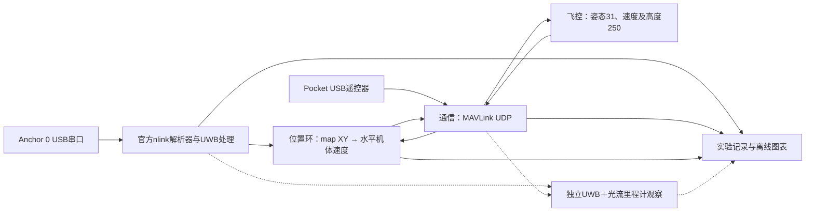

# Flapping-Wing UAV Navigation System

微型扑翼飞行器的ROS 2地面导航系统：接收UWB定位与飞控遥测，转发USB遥控器数据，在电脑上计算水平位置环和机体速度指令，并记录每次实验的数据与图表。

当前实现为**XY单目标点位置控制**。飞控负责速度环、姿态环、高度控制、解锁与手动/自动选择；地面站不执行自动起飞、降落或航点队列任务。软件链路已验证，实飞精度与控制增益仍需通过实验评估。

## 架构



- `communication.launch.py`：一个进程内运行遥控采集、映射及MAVLink桥接。
- `position_hold.launch.py`：位置控制器、UWB驱动、场景显示和实验记录器。坐标转换在位置控制器内部完成。
- `fusion_odometry.launch.py`：可选观察节点，独立发布融合结果，**不替换位置环的UWB输入，不发送飞控命令**。
- RViz展示四个基站、坐标轴、飞机姿态、定位轨迹和目标点。

## 环境与构建

已验证环境：Ubuntu 20.04、ROS 2 Foxy、GCC 9、C++17、Python 3.8。ROS节点主要使用C++；Python用于launch、测试编排和离线图表。

先安装ROS 2 Foxy。以下为已有ROS环境上的项目依赖：

```bash
sudo apt install build-essential cmake git python3-colcon-common-extensions   python3-rosdep libsdl2-dev python3-matplotlib python3-numpy python3-yaml   ros-foxy-joy ros-foxy-rviz2 ros-foxy-rosbag2 ros-foxy-rosbag2-storage-default-plugins
```

首次获取工程：

```bash
git clone https://github.com/Enhe1988/Flapping-Wing-UAV-Navigation-System.git ~/uwb
cd ~/uwb
bash scripts/fetch_dependencies.sh
# 首次使用rosdep时，先按本机环境完成rosdep init与update
rosdep install --from-paths src --ignore-src --rosdistro foxy -r -y
bash scripts/build.sh
```

官方Nooploop驱动与MAVLink C头文件固定在 [dependencies.repos](dependencies.repos) 指定的提交，不随本仓库上传。构建脚本使用外置Foxy兼容层，不修改驱动源码。

所有命令在工程根目录运行。`scripts/ros2.sh`会隔离ROS1等工作区的环境，只为其后的命令加载Foxy及本工程；单独运行它不会改变父终端环境。

## 日常启动与设置目标

先完成UWB设备标定，并确保串口和USB遥控器可访问。当前配置：Anchor 0串口输入、Tag 0、921600波特率。修改基站显示坐标不会修改UWB硬件内部标定。

**终端1：通信，保持运行。默认开启实际UDP发送。**

```bash
cd ~/uwb
bash scripts/ros2.sh ros2 launch flapping_uav_bringup communication.launch.py
```

**终端2：位置环、UWB、RViz及实验记录，保持运行。**

```bash
cd ~/uwb
bash scripts/ros2.sh ros2 launch flapping_uav_bringup position_hold.launch.py use_rviz:=true
```

默认串口为 `/dev/serial/by-id/usb-1a86_USB_Serial-if00-port0`。更换设备时追加 `port_name:=实际设备 baud_rate:=实际波特率`。若UWB已单独启动，使用 `start_uwb:=false`，避免重复打开串口。

**终端3：将机头朝向map +X、静置后执行。**

```bash
cd ~/uwb
bash scripts/ros2.sh ros2 service call /navigation/start_here std_srvs/srv/Trigger '{}'
```

成功后记录本次航向，将当时的当前位置设为目标并启用位置保持。飞控重新上电后必须重新对齐。这个服务不解锁或起飞；实体飞行仍由飞控端的模式和动力操作决定。

设置新的map目标点，例如 `(2.0, -2.0)` 米：

```bash
bash scripts/ros2.sh ros2 topic pub --once /navigation/goal geometry_msgs/msg/PoseStamped   '{header: {frame_id: map}, pose: {position: {x: 2.0, y: -2.0, z: 0.0}, orientation: {w: 1.0}}}'
```

也可在正常RViz窗口使用 **2D Goal Pose**。每次请求替换当前单目标，到达后持续保持。只使用XY，目标Z和朝向不参与控制。目标必须是转换后的map坐标，不能直接照抄原始UWB的Y。

查看导航状态和实际交给UDP的速度值：

```bash
bash scripts/ros2.sh ros2 topic echo /navigation/status
bash scripts/ros2.sh ros2 topic echo /fc/velocity_setpoint_sent
```

停用位置环并清除目标，通信和遥控转发继续运行：

```bash
bash scripts/ros2.sh ros2 service call /navigation/enable std_srvs/srv/SetBool '{data: false}'
```

完整流程、状态和异常恢复见 [位置控制说明](docs/position_hold.md)。

## 坐标与通信接口

| 项目 | 当前约定 |
|---|---|
| 本机现场IP | `192.168.1.100`，由电脑网卡配置 |
| UDP接收 | 绑定 `0.0.0.0:9000` |
| UDP发送 | `192.168.1.151:9111` |
| 目标飞控 | system/component `1/1` |
| 回传 | HEARTBEAT 0、ATTITUDE_QUATERNION 31、DEBUG_VECT 250 |
| DEBUG_VECT | X前向m/s、Y水平右向m/s、Z向上高度m；XY已补偿倾斜 |
| 发送 | HEARTBEAT 0、RC_CHANNELS_OVERRIDE 70、SET_POSITION_TARGET_LOCAL_NED 84 |
| 消息84 | frame 8、mask 3559，仅使用vx/vy；按目标飞控约定发送机体水平速度 |
| 输出符号适配 | 内部前正/右正；实际发送X不变、Y取反 |
| UWB → map | 当前 `map_x=uwb_x`、`map_y=-uwb_y`，再应用配置的旋转和平移 |
| 航向 | 当前场地+X沿A0→A3，map +Y向左；每次开始时运行记录 |

`/fc/velocity_setpoint_sent`证明电脑成功将数值交给UDP，不代表飞控已经执行。接口、坐标与符号说明见 [速度接口](docs/body_velocity_contract.md) 和 [UWB坐标](docs/uwb_map_alignment.md)。

## 独立融合里程计观察

已有UWB与飞控数据时，可另开终端：

```bash
bash scripts/ros2.sh ros2 launch flapping_uav_bringup fusion_odometry.launch.py use_rviz:=true
```

它自动读取有效的本次导航航向；单独观察、不运行位置控制器时，将机头朝+X并调用：

```bash
bash scripts/ros2.sh ros2 service call /fusion/align_positive_x std_srvs/srv/Trigger '{}'
```

UWB正常时校正XY，异常时依靠连续有效光流短时推算；默认最长2秒，之后停止刷新有效位置。输出为 `/fusion/odometry`、`/fusion/status`。正常控制仍只使用UWB，观察节点的启停不改变控制输入。见 [融合观察器](docs/fusion_odometry.md)。

## 实验记录与导出

位置环启动后默认创建独立实验目录 `log/experiments/<时间_标签_编号>/`，包含原始rosbag2、参数快照、CSV、事件和图表。

```bash
bash scripts/flight_log.sh status
bash scripts/flight_log.sh mark '开始位置保持'
# 实验结束后停止记录并自动导出
bash scripts/flight_log.sh stop
bash scripts/flight_log.sh open
# 下一次记录，无需重启控制节点
bash scripts/flight_log.sh start
```

通常输出9张图、PDF和自包含HTML；运行融合观察器时增加融合对比图。记录器的start/stop只操作日志。数据目录不进入Git，重要实验请另行备份。见 [日志说明](docs/experiment_logging.md)。

## 参数位置

| 文件 | 修改内容 |
|---|---|
| [position_hold.yaml](src/flapping_uav_bringup/config/position_hold.yaml) | Kp/Kd、速度及加速度限制、控制超时、2秒恢复窗口、发送Y符号 |
| [pocket_bench.yaml](src/flapping_uav_bringup/config/pocket_bench.yaml) | 当前通信/遥控共享基础配置、设备、通道映射、MAVLink来源 |
| [uwb.yaml](src/flapping_uav_bringup/config/uwb.yaml) | Tag、协议输入、UWB→map变换、定位时效 |
| [scene.yaml](src/flapping_uav_bringup/config/scene.yaml) | 四个基站的原始UWB坐标、显示设置 |
| [fusion_odometry.yaml](src/flapping_uav_bringup/config/fusion_odometry.yaml) | 观察器跳变门限、推算时长和校正增益 |
| [experiment_logging.yaml](src/flapping_uav_bringup/config/experiment_logging.yaml) | 记录队列、自动记录和自动导出 |

参数在启动时加载，修改后重启相关入口。当前文件的控制增益为Kp=1.0、Kd=0.0，限速2.0m/s、限加速度1.0m/s²；这是已有实验配置，不代表已完成实飞整定。改限速后同时重启通信与位置环，二者共享该限制。

通信地址可以通过launch参数覆盖，例如 `remote_ip:=192.168.1.151 tx_port:=9111 rx_port:=9000`。虽然基础文件为独立节点保留关闭发送的默认值，日常 `communication.launch.py` 会明确开启发送。

## 调试与测试

无硬件UWB演示：

```bash
bash scripts/ros2.sh ros2 launch flapping_uav_bringup uwb_demo.launch.py
```

独立UWB、重新打开RViz、仅接收MAVLink等命令见 [RViz显示](docs/rviz_scene.md) 与 [通信诊断](docs/mavlink_diagnostics.md)。不要同时启动两个串口驱动或两个绑定9000的通信接收器。

```bash
bash scripts/build.sh
# C++单元及ROS图测试，脚本自动使用独立DDS域、本机通信
bash scripts/test.sh
# 官方解析器的虚拟串口端到端验证，不连接实体设备
bash scripts/ros2.sh python3 scripts/check_uwb_serial.py
# 日志和融合观察器的独立模拟回归
bash scripts/ros2.sh python3 scripts/check_experiment_logging.py
bash scripts/ros2.sh python3 scripts/check_fusion_observer.py
```

测试结果、模拟报告和构建日志写入被忽略的 `log/`，模拟实验在 `log/experiments_demo/`，真实实验在 `log/experiments/`。运行测试不会证明实际定位精度或飞行性能。

## 目录与实现边界

```text
src/
├── flapping_uav_msgs/       # 带有效性、时间和坐标信息的项目消息
├── flapping_uav_gcs/        # C++节点、算法、回归测试与离线导出器
├── flapping_uav_bringup/    # 日常/独立/演示launch、YAML、RViz
└── nlink_parser2/           # 脚本获取的固定版本官方驱动，不提交
third_party/mavlink_c/       # 脚本获取的官方MAVLink头文件，不提交
scripts/                    # 环境、构建、测试、记录及诊断工具
docs/                       # 当前操作和接口文档
cmake/                      # Foxy兼容层
```

保留可重复运行的测试和诊断源码；不保存历史阶段报告、过期航向偏置、安装包或生成的测试证据。`build/`、`install/`、`log/`及外部依赖不上传。

[实施计划V2.1](微型扑翼飞行器_UWB自主飞行项目实施计划_V2.1.md)作为原始需求保留。后续确认的机体速度分工、0/31/250消息及9000/9111端口以本README和当前配置为准；原计划中的端口、NED发送分工和未实现任务不代表当前行为。

项目包声明使用 [Apache-2.0](LICENSE)；外部依赖遵循各自许可证。
